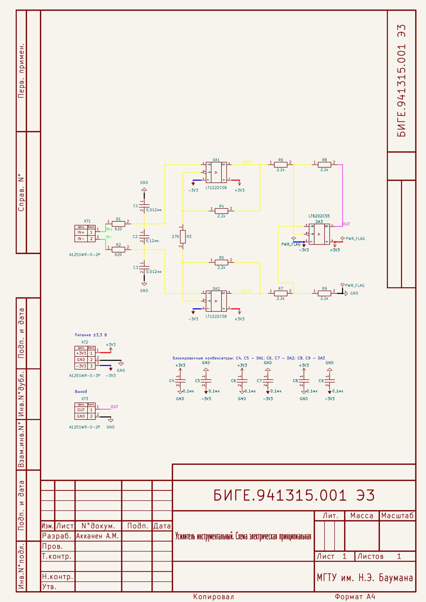
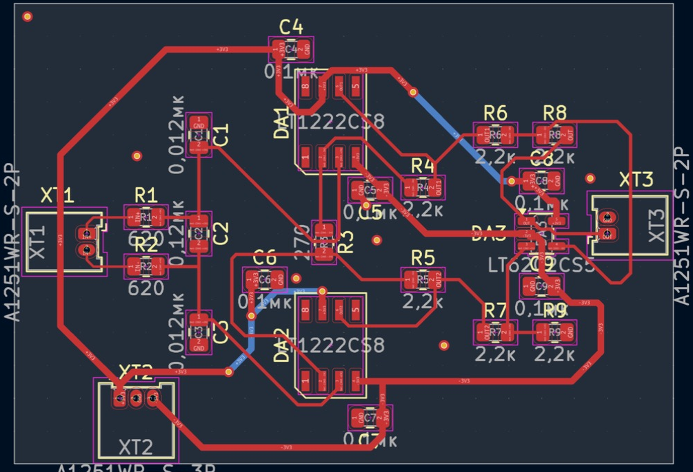
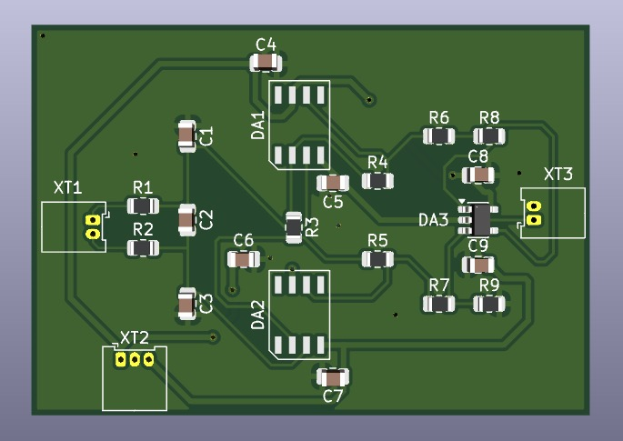

# Инструментальный усилитель на трёх ОУ

## 1. Назначение и схема

Плата — инструментальный усилитель на трёх операционных усилителях:

| Каскад | Элементы | Функция |
|---|---|---|
| Входной фильтр | R1, R2, C1–C3 | ФНЧ: подавление синфазных и дифференциальных ВЧ-помех |
| Входной каскад | DA1, DA2 (LT1222), R3–R5 | Неинвертирующие усилители с общим резистором R3 |
| Выходной каскад | DA3 (LT6202), R6–R9 | Дифференциальный усилитель, перевод в несимметричный выход |
| Блокировка питания | C4–C9 | По 0,1 мкФ на каждый вывод питания ОУ |
| Разъёмы | XT1 (вход), XT2 (питание ±3,3 В), XT3 (выход) | Разъёмы с шагом 1,25 мм |

**Коэффициент усиления:**

K = (1 + 2·R4 / R3) · (R8 / R6) = (1 + 2·2,2 кОм / 270 Ом) · 1 ≈ **17,3**

LT1222 устойчив при шумовом усилении ≥ 10; в первом каскаде оно ≈ 17,3.

**Входной фильтр:**
- дифференциальная полоса: f = 1 / (2π · 2R1 · (C2 + C1/2)) ≈ 1,0 кГц
- синфазная полоса: f = 1 / (2π · R1 · C1) ≈ 21 кГц
- C2 ≥ 10·C1 — разбаланс C1/C3 слабо влияет на подавление синфазного сигнала.

**Питание:** двуполярное ±3,3 В (6,6 В), в пределах допустимого для LT1222 (от 5 В) и LT6202 (до 12,6 В).

## 2. Структура репозитория

```
amplifier-pcb/
├── amplifier.kicad_pro      проект KiCad (классы цепей, правила)
├── amplifier.kicad_sch      схема электрическая принципиальная
├── amplifier.kicad_pcb      печатная плата
├── amplifier.kicad_dru      пользовательские правила DRC (нормы Резонит)
├── sym-lib-table            подключение библиотеки символов (относительный путь)
├── fp-lib-table             подключение библиотеки посадочных мест (относительный путь)
├── gost_portrait.kicad_wks  рамка и основная надпись по ГОСТ (А4, книжная)
├── gost_landscape.kicad_wks рамка по ГОСТ (альбомная)
├── library/                 git-сабмодуль → my-kicad-library
├── scripts/check.sh         ERC, DRC, Gerber, BOM, PDF
├── docs/                    скриншоты платы, PDF схемы
├── README.md
└── README.pdf               отчёт (PDF-версия этого файла)
```

Клонирование вместе с библиотекой:

```bash
git clone --recursive https://github.com/kolmeto1sta3-akk/amplifier-pcb.git
# если уже склонировано без --recursive:
git submodule update --init
```

## 3. Библиотека компонентов (git-сабмодуль)

Библиотека вынесена в отдельный репозиторий [my-kicad-library](https://github.com/kolmeto1sta3-akk/my-kicad-library) и подключена как сабмодуль в папку `library/`.

Пути подключения — **относительные**, через переменную `${KIPRJMOD}` (папка проекта), поэтому проект открывается на любом компьютере без настройки:

| Таблица | Имя | Путь |
|---|---|---|
| `sym-lib-table` | MySymbols | `${KIPRJMOD}/library/symbols/MySymbols.kicad_sym` |
| `fp-lib-table` | MyFootprints | `${KIPRJMOD}/library/footprints/MyFootprints.pretty` |

**Состав библиотеки:**

| УГО | Поз. обозн. | Посадочное место | Партномер |
|---|---|---|---|
| LT1222 (ОУ) | DA | SOIC-8_3.9x4.9mm_P1.27mm | LT1222CS8#PBF |
| LT6202 (ОУ) | DA | SOT-23-5 | LT6202CS5#TRMPBF |
| R (резистор) | R | R_0805_2012Metric | по номиналу |
| C (конденсатор) | C | C_0805_2012Metric | по номиналу |
| A1251WR-S-2P_IN / _OUT | XT | Molex_PicoBlade_53048-0210 (2 конт.) | A1251WR-S-2P |
| A1251WR-S-3P_PWR | XT | Molex_PicoBlade_53048-0310 (3 конт.) | A1251WR-S-3P |

**Оформление УГО по ГОСТ:**
- ОУ — ГОСТ 2.759-82: основное поле со знаком «▷» и два дополнительных поля для меток выводов (входы и V− слева, выход и V+ справа), отделённые вертикальными линиями; инвертирующий вход обозначен кружком;
- резистор и конденсатор — ГОСТ 2.728-74;
- разъёмы — таблицей «Цепь / Конт.»;
- буквенные позиционные обозначения — ГОСТ 2.710-81 (DA, R, C, XT).

Площадки разъёмов PicoBlade расширены до 0,9 мм, чтобы поясок вокруг отверстия 0,5 мм был не меньше 0,2 мм (норма Резонита).

## 4. Схема электрическая принципиальная

- **Оформление.** Лист А4, рамка и основная надпись по ГОСТ 2.104 (`gost_portrait.kicad_wks`), обозначение документа с кодом **Э3**.
- **Поле `Manufacturer_Part_Number`.** Заведено у всех компонентов, партномера подобраны на [lcsc.com](https://www.lcsc.com).

**Классы цепей** («Файл → Параметры схемы → Классы цепей»), с цветовым обозначением:

| Класс | Цепи (шаблон) | Цвет | Ширина дорожки |
|---|---|---|---|
| Power + | `+3V3` | красный | 0,5 мм |
| Power − | `-3V3` | синий | 0,5 мм |
| GND | `GND` | чёрный | 0,5 мм |
| Analog_IN | `*IN+`, `*IN-` | зелёный | 0,25 мм |
| Analog_OUT | `*OUT` | фиолетовый | 0,25 мм |
| Analog_SIGNAL | `*OUT1`, `*OUT2`, `Net-(*` | жёлтый | 0,25 мм |

> Шаблоны начинаются со `*`: у локальной метки полное имя цепи содержит путь листа (`/IN+`), поэтому шаблон `IN+` без звёздочки не срабатывает.



Полная схема в векторном виде: [`docs/amplifier_schematic.pdf`](docs/amplifier_schematic.pdf).

**Перечень элементов (BOM)** — формируется скриптом из поля `Manufacturer_Part_Number`:

| Поз. обозначение | Номинал | Корпус | Партномер (Manufacturer_Part_Number) | Кол. |
|---|---|---|---|---|
| C1, C3 | 0,012 мкФ | 0805 | CL21B123KBANNNC (Samsung) | 2 |
| C2 | 0,12 мкФ | 0805 | C0805C124K1RACTU (KEMET) | 1 |
| C4–C9 | 0,1 мкФ | 0805 | CL21B104KBFNNNE (Samsung) | 6 |
| DA1, DA2 | LT1222CS8 | SOIC-8 | LT1222CS8#PBF (Analog Devices) | 2 |
| DA3 | LT6202CS5 | SOT-23-5 | LT6202CS5#TRMPBF (Analog Devices) | 1 |
| R1, R2 | 620 Ом | 0805 | RC0805FR-07620RL (Yageo) | 2 |
| R3 | 270 Ом | 0805 | RC0805FR-07270RL (Yageo) | 1 |
| R4–R9 | 2,2 кОм | 0805 | RC0805FR-072K2L (Yageo) | 6 |
| XT1, XT3 | вилка 2 конт. | шаг 1,25 мм | A1251WR-S-2P (CJT) | 2 |
| XT2 | вилка 3 конт. | шаг 1,25 мм | A1251WR-S-3P (CJT) | 1 |

**Результат ERC:** 0 нарушений.

## 5. Печатная плата и технологичность (DFMA)

Нормы завода «Резонит», базовый уровень, фольга 35 мкм ([источник](https://www.rezonit.ru/pcb/odnostoronnie-i-dvustoronnie/serial/)):

| Параметр | Резонит | В проекте |
|---|---|---|
| Ширина проводника / зазор | ≥ 0,2 / 0,2 мм | 0,25 (сигнал), 0,5 (питание) / 0,2 мм |
| Мин. металлизированное отверстие | 0,3 мм | 0,3 мм |
| Поясок площадки (PAD) | 0,2 мм | 0,2 мм (правило в `.kicad_dru`) |
| Поясок переходного отверстия | 0,15 мм | 0,15 мм |
| Медь от края платы | 0,25 мм | 0,5 мм |
| Шелкография: линия / высота шрифта | 0,15 / 1,0 мм | 0,15 / 1,0 мм |

**Решения DFMA:**
- двусторонняя плата FR-4 1,6 мм, все компоненты на верхней стороне — один проход монтажа;
- единый типоразмер пассивных компонентов 0805 — удобно и для ручной, и для автоматической пайки;
- компоненты ориентированы только под 0° / 90°, разъёмы у края платы;
- сплошной полигон GND на нижнем слое, блокировочные конденсаторы рядом с выводами питания;
- входные цепи IN+ / IN− разведены симметрично;
- позиционные обозначения на шелкографии читаемы и не заходят на площадки.

**Трассировка:**
- плата 50 × 35 мм, 2 слоя, 124 сегмента дорожек, 12 переходных отверстий;
- сигнальные цепи — 0,25 мм, питание ±3,3 В и GND — 0,5 мм;
- изломы дорожек только под 45° (угол 135°): острых и прямых углов нет, выходы из площадок — прямые или под 45°;
- все сигнальные цепи и питание — на верхнем слое; на нижний слой выведены только два участка +3V3, чтобы пересечь другие цепи;
- нижний слой — сплошной полигон GND; верхний слой залит GND, островки полигона верхнего слоя сшиты с нижним переходными отверстиями GND (0,8/0,4 мм);
- контакты GND разъёмов XT2, XT3 подключены к полигонам сплошным соединением (термобарьер не помещается между контактами с шагом 1,25 мм).

**Результат проверки DRC:** 0 нарушений, 0 неразведённых соединений, 0 расхождений со схемой.





## 6. Скрипт проверки и выпуска документации

`scripts/check.sh` (macOS / Linux) последовательно выполняет:

1. **ERC** — проверка схемы (`output/erc.rpt`), при ошибках скрипт останавливается;
2. **DRC** — проверка платы и её соответствия схеме (`output/drc.rpt`);
3. **Gerber + Excellon** — `output/gerbers/`, архив `amplifier_gerbers.zip` для заказа в Резоните;
4. **BOM** — перечень элементов с партномерами `output/amplifier_BOM.csv`;
5. **PDF схемы** — `output/amplifier_schematic.pdf`.

Запуск:

```bash
./scripts/check.sh
```

Используется `kicad-cli` из состава KiCad 10.

Результат последнего запуска:

```
=== 1/5 ERC ===  Найдено 0 нарушений
=== 2/5 DRC ===  Найдено 0 нарушений, 0 неподключенных элементов, 0 проблем с соответствием схеме
=== 3/5 Gerber + сверловка ===  F_Cu, B_Cu, F_Paste, F/B_Silkscreen, F/B_Mask, Edge_Cuts, amplifier.drl
=== 4/5 BOM ===  output/amplifier_BOM.csv
=== 5/5 PDF схемы ===  output/amplifier_schematic.pdf
```
